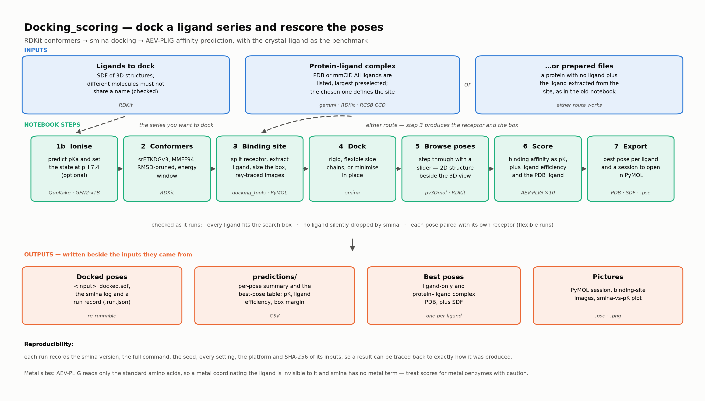

# ZIKV NS2B-NS3 protease — docking and scoring

A worked example of docking a ligand series into the **Zika virus NS2B-NS3 protease** and
rescoring the poses, from conformer generation through to predicted binding affinity.

1. **RDKit** generates a diverse, low-energy conformer set for each ligand.
2. **QupKake** predicts the protonation state at pH 7.4 (optional, but it matters here).
3. The binding site is taken from the protein–ligand complex; the ligand is extracted for you.
4. **smina** docks the conformers, rigidly or with flexible side chains.
5. **AEV-PLIG** predicts the binding affinity (pK) of every pose.

Everything is driven from `ZIKV_DockingScoring.ipynb`. The pipeline code is in
`docking_tools.py`; it is the same machinery as
[Docking_scoring](https://github.com/drc007/Docking_scoring), pointed at a different target.



## The target

ZIKV NS2B-NS3 protease cleaves the viral polyprotein and is required for replication. It is a
**two-component** enzyme, and both parts are in `ZIKV_NS2B-NS3_protease.pdb`:

- **chain B** — the NS3 protease domain, carrying the catalytic triad **His51–Asp75–Ser135**;
- **chain A** — a ~40-residue cofactor peptide from NS2B that wraps around NS3 and completes the
  substrate groove.

Both are needed. Of the 17 residues within 5 Å of the bound ligand, **3 come from NS2B**
(Ser81, Gly82, Asp83) and 14 from NS3, so docking into the protease domain alone would be wrong.

The site is shallow, polar and strongly prefers basic P1 groups, so most known inhibitors are
**cationic** — including the bound ligand,
`[NH3+]Cc1cccc(NC(=O)c2cc(Cl)cc(NC(=O)OCc3ccccc3)c2)c1`, and every ligand in the example set.
That is why the pH 7.4 step is not optional here.

There is **no metal** in this binding site, so the metalloenzyme caveat that applies to some
targets does not apply.

## The worked example

`Trial10.sdf` holds nine close analogues built around an isoindoline–benzamide scaffold. They
are deliberately similar, which makes the example a good illustration of what these methods can
and cannot resolve.

Two things about this file are worth knowing, because both are common in real data:

- The records are **titled with their SMILES**, not names. The notebook detects this and offers
  the `Molecule_Name` field (`blind_challenge_001` …) as the ligand ID instead. Take it — the
  name ends up in pose file names, results tables and plot labels.
- Eight of the nine protonate at an **isoindoline NH**; the ninth (`blind_challenge_008`) is the
  regioisomer where that nitrogen sits on the aromatic ring, making it aniline-like and far less
  basic. QupKake predicts pKa 4.8 for it and the notebook correctly leaves it neutral.

## Setup

### 1. Conda environment and Jupyter kernel

```bash
conda env create -f environment.yml
```

```bash
conda run -n docking_scoring python -m ipykernel install --user --name docking_scoring --display-name "Python (docking_scoring)"
```

`environment.yml` is portable (macOS and Linux) and installs current versions. `docking_scoring.yml` pins the exact versions this was developed and tested with on an Apple-silicon Mac:

| Package | Tested version |
|---|---|
| Python | 3.12 |
| RDKit | 2026.09 |
| PyTorch | 2.10 (conda-forge) |
| torch-geometric | 2.8 |
| torchani | 2.9 |
| PyMOL (open source) | 3.1 |
| Open Babel | 3.2 |
| gemmi | 0.7 |
| py3Dmol | 2.5 |
| ipywidgets | 8.1 |
| JupyterLab | 4.6 |

> **Install PyTorch from conda-forge, not pip.** The pip wheel bundles its own OpenMP library, which clashes with conda's and crashes on import with `OMP: Error #15`.

### 2. AEV-PLIG trained models

The trained models (about 300 MB) are not stored in this repository. Download them from the official [AEV-PLIG repository](https://github.com/oxpig/AEV-PLIG):

```bash
conda run -n docking_scoring python aev_plig/download_models.py
```

The script fetches the 10-model `model_GATv2Net_ligsim90_fep_benchmark` ensemble and its scaler from a fixed upstream commit, checks each file's checksum, and saves them to `aev_plig/output/trained_models/`.

### 3. smina

smina is not included in `environment.yml`: the conda-forge smina package (2020 build) needs an old version of Boost that forces an old RDKit. Install it in one of two ways:

- **A separate conda environment**, which the notebook finds automatically:

  ```bash
  conda create -n smina -c conda-forge smina
  ```

- **The prebuilt binary** from https://sourceforge.net/projects/smina/. Make it executable (`chmod +x`), then put it on your `PATH` or set the `SMINA` environment variable to its full path.

The notebook looks for smina in this order:

1. the `SMINA` environment variable;
2. `smina`, `smina.static` or `smina.osx.12` in the notebook's environment or on the `PATH`;
3. a conda environment called `smina`;
4. `/usr/local/smina.osx.12` and other common locations.

You can also type the path into the smina panel.

### 4. Run

Open `ZIKV_DockingScoring.ipynb` with the **Python (docking_scoring)** kernel. Each step has a
panel with a **Run** or **Apply** button; set `AUTO_RUN = True` in the first code cell to run
everything with the defaults.

To dock your own ligands, change `LIGAND_SDF` in section 1. To use a different protein, change
the paths in section 3. Nothing else is target-specific, and all output is written next to the
input it came from.

## Results from this example

`ZIKV_DockingScoring.html` and `.pdf` are a fully executed copy of the notebook, so you can read
every result, image and table without running anything.

Generated files (docked SDFs, `predictions/`, pose directories) are **not** tracked — see
`.gitignore`. Run the notebook to recreate them.

## Three things this example demonstrates

**smina can write poses RDKit cannot read.** smina re-perceives bond orders when it writes its
output and mis-Kekulises some fused aromatic N-heterocycles, leaving an impossible valence. It
affects *every* pose of the ligand concerned, so without handling it that ligand simply vanishes
from the results with no warning. `load_poses` rebuilds such poses from the submitted molecule,
keeping the heavy-atom coordinates exactly. In this nine-ligand example it rescues one ligand
(18 of 540 poses); on a 400-ligand set it rescued **108 of 400 ligands**.

**A flexible `minimizedAffinity` is not a ligand binding score.** It also covers the flexible
side chains' own energy terms, so it runs several kcal/mol lower than the ligand–receptor
interaction and cannot be compared with a rigid run or with the reference ligand. The best-pose
table therefore also carries **`smina_interaction`**, the pose re-scored against its own receptor
with `--score_only`. After rigid docking the two agree, so that column means the same thing in
both modes and is the one to compare across runs.

**AEV-PLIG pK correlates strongly with ligand size.** On a 400-ligand set, Spearman(heavy atoms,
pK) = +0.68, while ligand efficiency runs the other way at −0.91 — the top 25 by each measure
shared no compounds at all. Rank on pK if you are predicting affinity, on LE if you are looking
for efficient starting points, but know that either ranking is substantially a size ranking.

## Licence and citation

Code in this repository is MIT licensed (see `LICENSE`). Please also cite the underlying tools:

- **AEV-PLIG** — Valsson *et al.*, *Commun. Chem.* 2025; https://github.com/oxpig/AEV-PLIG
- **smina** — Koes, Baumgartner & Camacho, *J. Chem. Inf. Model.* 2013, 53, 1893
- **AutoDock Vina** — Trott & Olson, *J. Comput. Chem.* 2010, 31, 455
- **QupKake** — Abarbanel & Hutchison, *J. Chem. Theory Comput.* 2024, 20, 6946
- **RDKit** — https://www.rdkit.org
